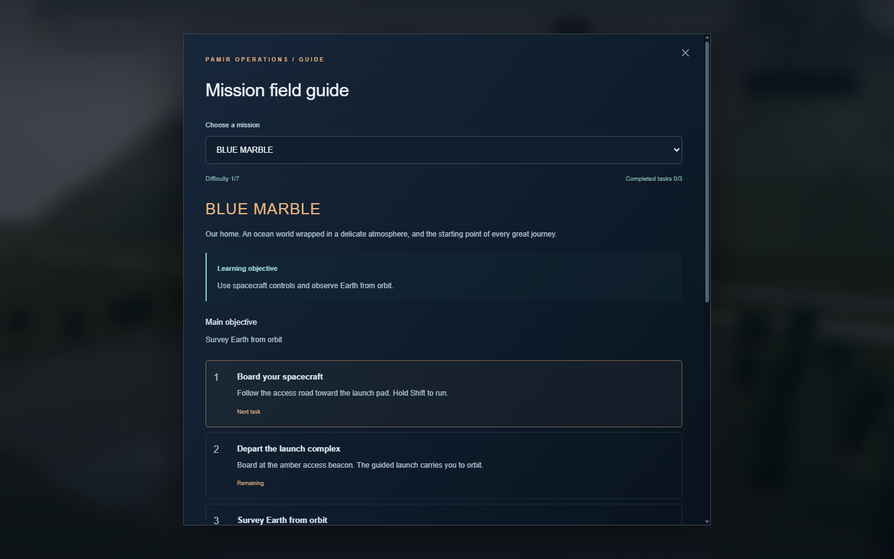
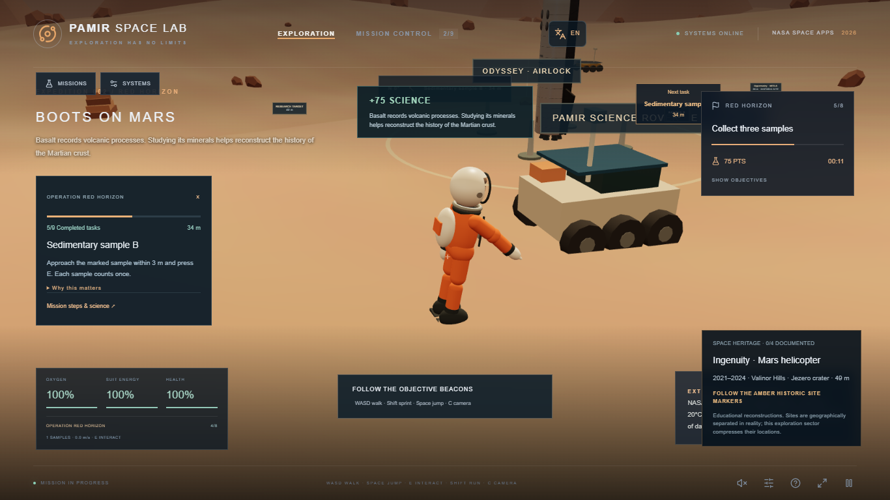

# Mission guidance

Open **Mission field guide** from the menu or Mission Control, or **Mission steps & science** in the in-game assistant. On a phone, tap the compact current-task strip. The guide pauses gameplay through the existing operations-panel input lock. Close it to continue the simulation.

The guide covers **12 mission paths**: Earth departure, Moon sample return, Operation Red Horizon, Orbital Rescue, Red Planet Research, Lunar Discovery, Mercury/Venus robotic exploration and the four giant-world instrument missions. The suggested order introduces walking and observation before landings, maintenance, laboratory work and remote instruments.

Every path contains a context, learning objective, main objective, numbered tasks, interaction instructions, hints, completion criteria and a scientific takeaway. Each guide links to its NASA reference. Exact landing, proximity, speed, hold-time and resource requirements appear with the relevant task. Existing scoring, physical landings, equipment actions, unlocks and duplicate-reward protection remain authoritative.

## In the world

The assistant displays the first unfinished task and its completed/total count. An amber ring, vertical beacon and label identify the next surface/interior interaction. Markers advance when an actual task completes. Existing orbital relay/airlock markers and landing-zone guidance remain in use. The laboratory marker first points to the south doorway, then to the console after entry. Failed landings, low EVA oxygen, cabin piloting and active probe reception receive contextual hints.

Mission Control and the guide show completed and remaining steps. Finishing a mission produces a short scientific debrief. Opening or reading a guide never completes a task or adds points. Revisited completed missions retain their checkmarks; current save data determine progress.

On Mars, an accepted research operation directs the player to the laboratory as soon as A/B/C are collected, while EVA remains controllable. **Continue Exploring** on the Red Horizon results screen also resumes EVA with the samples and objectives intact, allowing unfinished base research to continue.

Earth boarding/departure records are stored with zero rewards in the existing planetary research save, only after the guarded boarding action and actual ascent finish. Old saves without those records do not fabricate a completed launch: their guide explains how to return for departure training or continue to the Moon. Existing planet/sample identifiers are unchanged. Protected demonstrations do not write departure records to normal progress.

## Scientific scope

The educational mission hardware, terrain, travel time and measurements are simplified. The guide distinguishes astronaut exploration, remote robotic landing and giant-planet orbital science. Scientific takeaways draw from the linked [NASA Moon facts](https://science.nasa.gov/moon/facts/), [spacewalk overview](https://www.nasa.gov/international-space-station/space-station-spacewalks/) and the NASA destination/mission references already attached to each world. For example, Jupiter has no solid surface for an astronaut landing, while the Moon's extremely tenuous exosphere provides no useful atmospheric braking.

## Verification

`npm test` includes `check-mission-coach.mjs`: all 12 mission structures and their Tajik/Russian translations, read-only guide access, guarded Earth boarding/launch, out-of-order Mars samples, moving lunar targets and actual sample return, a real giant-world survey/probe/uplink loop, reward duplication, cabin hints, oxygen and retry handling.

After `npm run build`, `node --experimental-strip-types scripts/qa-mission-coach.mjs` runs an isolated Chrome check against the production build under a Pages-style subpath. It exercises desktop guide opening/selection, a Russian lunar saved-game fixture with actual collection, and the phone guide and input lock. Screenshots and results go to ignored `artifacts/mission-coach/`. Browser emulation does not substitute for physical-device performance testing.
