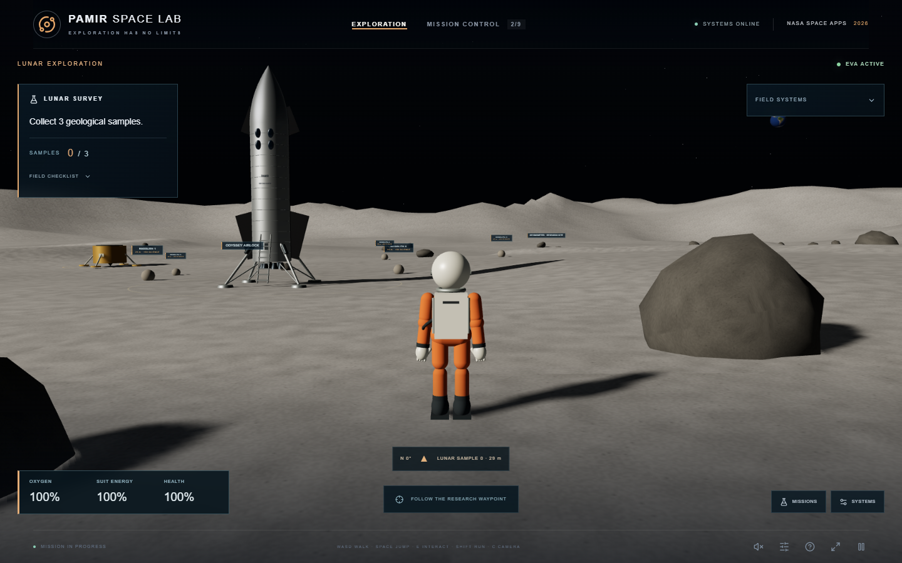

# PAMIR SPACE LAB — BEYOND EARTH

**A playable 3D space-science adventure built for a NASA Space Apps hackathon presentation.**

Pilot a spacecraft, learn the constraints of a safe planetary landing, explore as an astronaut, collect geological samples and turn them into research. Built by the PAMIR SPACE LAB team with TypeScript, React and Three.js. No paid API, account or API key is required to play.

## Start here, judges

### [▶ PLAY IN YOUR BROWSER](https://sino07815-cpu.github.io/pamir-space-lab/)

No installation or account required. Open on a WebGL-capable computer or phone. Phones get a movement joystick, swipe camera and contextual hold buttons; landscape is recommended. Keyboard and mouse remain available on computers. Click **ENABLE SOUND**, then **JUDGE BRIEFING / DEMO GUIDE** for the presentation route. The live link becomes available after the repository's **Publish playable demo** deployment succeeds.

**Тоҷикӣ · Русский · English:** choose the interface language on first launch. Use the language icon in the top header to change it later. Your choice is remembered on this browser; mission progress and scores remain unchanged. Menus, mission instructions, scientific notes, controls and results are translated. See [language support and verification](LOCALIZATION.md).

**Phone controls:** drag the left stick to walk / fly / drive, swipe the 3D world or **SWIPE TO LOOK** area to turn, tap **INTERACT**, and hold **THRUST**, **BOOST** or **HOLD SCAN** when required. The footer has pause and sound controls. Use **How to Play → Enable touch controls** to switch layouts manually. Phones start at LOW graphics; the quality setting remains adjustable. See [mobile controls and validation](MOBILE.md).

Open the game and choose **JUDGE BRIEFING / DEMO GUIDE → START PROTECTED PRESENTATION**. The guided route demonstrates Gateway docking, orbital EVA repair, a Mars landing, sample collection and laboratory analysis using the actual gameplay actions. Normal progress is protected and restored when the presentation ends.

Allow **3–5 minutes**. The model route completes in about 146 simulated seconds; wall-clock duration depends on rendering and pauses. The separate Mars Judge Demo takes about 201 simulated seconds and replaces the current Red Horizon run. The briefing explains that difference before starting.

[Presentation script](DEMO_SCRIPT.md) · [Release checklist](RELEASE_CHECKLIST.md) · [Detailed gameplay guide](GAMEPLAY_GUIDE.md)

## Lunar exploration update

The Moon scene now has cratered regolith, continuous distant ridges, a visible Sun, a small distant Earth, ground-contact shadows, a brushed-metal reusable lander with landing gear and a walking boot trail. Its compact survey/descent HUD also supports touch controls. See [lunar visuals and verification](LUNAR_VISUALS.md) and [visible Sun](SUN.md).



## Why it matters

Space exploration requires decisions, observation and evidence. This prototype makes learners practice those actions rather than only reading facts. Landing velocity and fuel affect success; scientific objects require proximity and distinct collection; sample analysis connects exploration with research.

The intended audience is students and science-event visitors using an ordinary laptop. Learning outcomes have not yet been measured. The next evaluation is a learner study of landing trade-offs, sample analysis and mission safety.

## Solar System mission update

Choose **SOLAR SYSTEM MISSIONS** from the menu or Mission Control. Mercury and Venus now have interactive robotic descent, rover research and data-return missions. Jupiter, Saturn, Uranus and Neptune have stable-orbit surveys, visible instrument probes and research uplinks. Earth, Mars and Moon gameplay remains available. See [Planet expeditions](PLANET_EXPEDITIONS.md) for controls, sources and limitations.

## Implemented gameplay

**Mission guidance:** a field guide covers 12 mission paths with ordered tasks, short scientific explanations, actual progress and post-mission takeaways. Amber beacons identify the next interaction; phone players tap the compact next-task strip. See [mission guidance and validation](MISSION_GUIDANCE.md).

- Eight planets and the Moon with locally bundled, attributed maps, relative mean-size ratios and display rotation.
- Spacecraft acceleration, steering, chase/cockpit cameras, navigation, surveys and persistent scores.
- Fictional Earth launch complex with a walkable campus, alpine landscape and reusable-rocket ascent.
- Interactive Mars and lunar landings with altitude, velocity, fuel, guidance, failure and retry.
- Astronaut walking, jumping, suit resources, proximity interactions, Mars samples and lunar research.
- Mars rover, research base, laboratory analysis and resource-management missions.
- Gateway rendezvous, guarded docking, station/cabin interiors and tethered orbital repair.
- Historical hardware reconstructions and an Earth-orbit reference catalog; these are educational representations, not live tracked spacecraft.
- Mission Control, contextual Mission Assist, protected presentation mode and generated opt-in audio.

## Run locally

Install **Node.js 24 LTS**, then in the project folder:

```powershell
npm ci
npm run dev
```

Open the local URL printed by Vite. For a stable presentation build:

```powershell
npm test
npm run build
npm run preview -- --port 4173
```

Open http://127.0.0.1:4173/ and keep the terminal running. A WebGL-capable desktop browser with hardware acceleration is required. Choose LOW graphics on slower hardware. Audio unlocks on a normal gameplay-start click, or with **ENABLE SOUND**. Explicit mute is remembered; use the footer mixer for volume and test sounds.

The source-level tests use Node's TypeScript stripping (Node 22.18+ or 24). Dependencies must be downloaded once; the installed local game uses bundled assets and can run without venue internet. Optional NASA reference links require internet.

## Sound update

An original generated soundscape now covers engines, landings, footsteps, rover/robot motors, samples, probes, docking, alarms, interface actions and mission completion. **ENABLE SOUND** and the footer mixer provide volume, mute and playable previews. See [Sound design and verification](SOUND.md).

## Controls

| Key | Action |
| --- | --- |
| WASD / mouse | Move and steer / camera look |
| Shift | Boost spacecraft / run |
| Space | Brake in space; jump on foot; thrust in manual descent |
| E | Interact, collect, board or exit when in range |
| C | Switch camera |
| F | Survey nearby planet |
| M / H | Mission Control / flight guide |
| B / V on Earth | Campus overview / cosmonaut portrait |
| Esc | Release mouse and pause |

Detailed EVA, rover, mission and recovery controls are in the in-game guide and [gameplay documentation](GAMEPLAY_GUIDE.md).

## Science and honesty

The local science archive links NASA educational sources for [Mars](https://science.nasa.gov/mars/facts/), [the Moon](https://science.nasa.gov/moon/facts/), [Perseverance sampling](https://science.nasa.gov/mission/mars-2020-perseverance/science/) and MOXIE. [Planet texture attribution](public/textures/ATTRIBUTION.md) covers the locally bundled Solar System Scope maps under CC BY 4.0.

This is an educational game simulation: travel distances and time are compressed; gravity, entry, thrust, docking and life support are simplified; terrain, Gateway and the Earth campus are fictional. It is not flight software, live telemetry or a geographically accurate landing site. NASA-inspired styling does not imply NASA sponsorship or endorsement. The team should state its exact official challenge and members in the hackathon submission.

## Architecture and verification

React + TypeScript + Vite; React Three Fiber, Drei and Three.js for rendering; Zustand for game state and local persistence; Tailwind/CSS and Lucide for the interface. Procedural geometry and instancing reduce reliance on downloaded models. No backend or user account is needed.

`npm test` checks flight, mission progression, landings, collision, proximity, duplicate rewards, persistence, docking/EVA, research, protected presentation saves, planet maps, orbit layout, spaceport access, contextual guidance, audio, touch input, lunar terrain, deployment assets and localization. These automated tests do not replace visual review, a manual playthrough or performance measurements on the presentation laptop. See [the checklist](RELEASE_CHECKLIST.md) for outstanding manual checks.

GitHub Actions verifies tests and the production build on pushes and pull requests. **Publish playable demo** deploys GitHub Pages on pushes to `main` and can also be triggered manually. Set repository Settings → Pages → Source to GitHub Actions before running it. A hosted URL is live only after that workflow succeeds. Relative asset paths support hosting under `/pamir-space-lab/`.

## Further documentation

[Planetary missions](PLANETARY.md) · [Gateway and research](PHASE3.md) · [Planet visuals](PLANETS.md) · [Earth orbit catalog](EARTH_ORBITS.md) · [Historical exploration](EXPLORATION.md) · [Alpine campus](PAMIR_CAMPUS.md)
